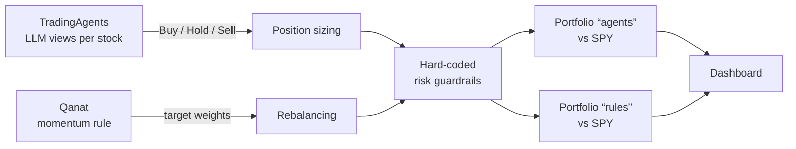

# AI Trading Lab

Can a team of LLM agents make better portfolio decisions than a simple rule? This project tests it honestly, on two **simulated** US equity portfolios run side by side, each measured against simply buying SPY.

> The source code is private. This page describes what the system does and how it is built. No real orders are placed: there is no broker connection.

<!-- Add a screenshot of the dashboard here: both portfolios vs SPY -->

## The experiment

| Portfolio | Who decides | Engine |
|---|---|---|
| `agents` | A multi-agent LLM system: analysts, a bull/bear debate, a trader and a risk committee give a view on each stock | [TradingAgents](https://github.com/TauricResearch/TradingAgents) (open source) |
| `rules` | A fixed momentum rule: hold the 3 best-performing S&P 500 sector ETFs over 126 sessions, rebalanced every 28 days | [Qanat](https://github.com/fidetolabs/qanat) (open source) |

Both engines stop at an opinion or at target weights. **What I built is everything after that:** order sizing, risk guardrails, portfolio accounting, the daily automated run and the monitoring dashboard.

## Design choices

- **Guardrails the agents cannot touch:** maximum weight per stock, maximum order size, minimum cash buffer, daily buy limits, no leverage or short selling. A 15% drawdown from peak suspends buying until a human resumes it. Limits are rechecked at execution.
- **Realistic simulation:** decisions made on day D execute at the next open, with slippage and per-order fees, dividends and stock splits handled.
- **Fair benchmark:** each portfolio is compared with the same capital put in SPY on day one, with the same costs.
- **Fully automated:** nightly run with catch-up of missed sessions; if one portfolio fails, the other still runs.
- **Tested:** 75 automated tests covering accounting, every guardrail, both decision cycles, the CLI and the dashboard, including a run of the real Qanat pipeline on a synthetic market.

## What I learned so far

- **Backtests flatter.** The classic sector momentum rule, replayed from 2006 to 2026, underperformed SPY. I kept it as a simple, verifiable baseline rather than a recommended strategy.
- **LLM decisions cannot be backtested.** A model may have seen past periods during training, so only forward, live testing counts.
- **A few weeks prove nothing.** The dashboard flags results as noise until there are at least 40 sessions of data.

## Status

The `rules` portfolio runs daily on real market prices. The `agents` portfolio is fully wired and tested offline with a scripted model; live runs with a paid model are the next step.

## Stack

Python · TradingAgents · Qanat · Yahoo Finance data · pytest

## How I built it

I defined the experiment, the risk framework and the evaluation method, and I run it. The code was written with Claude Code as an AI pair programmer.
